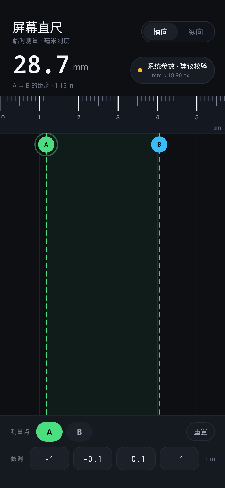
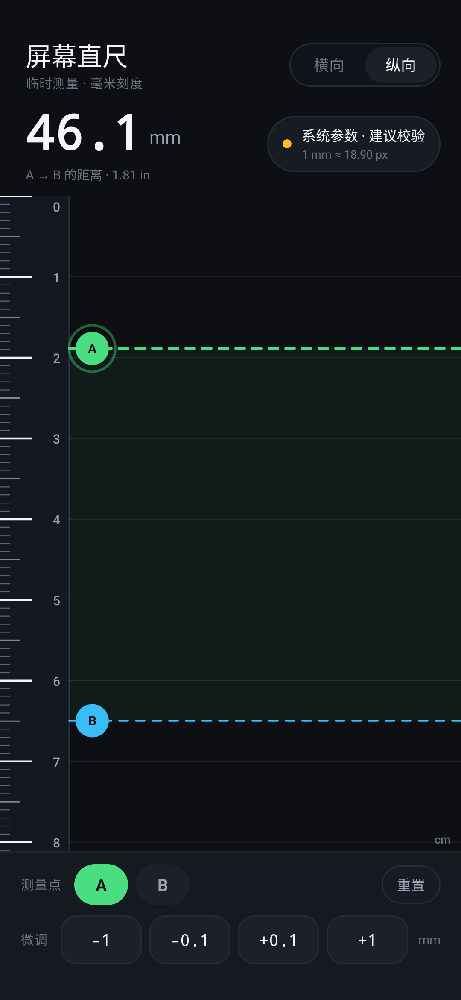
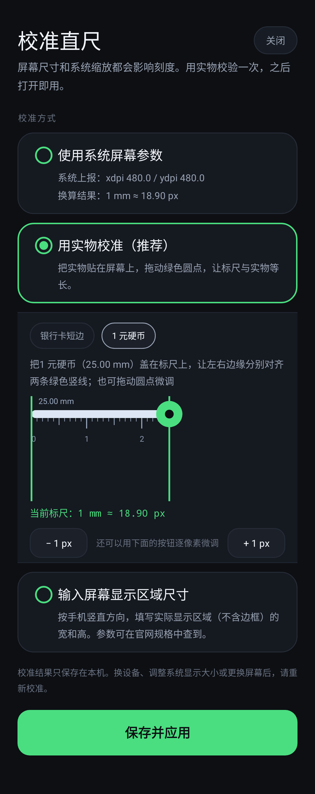
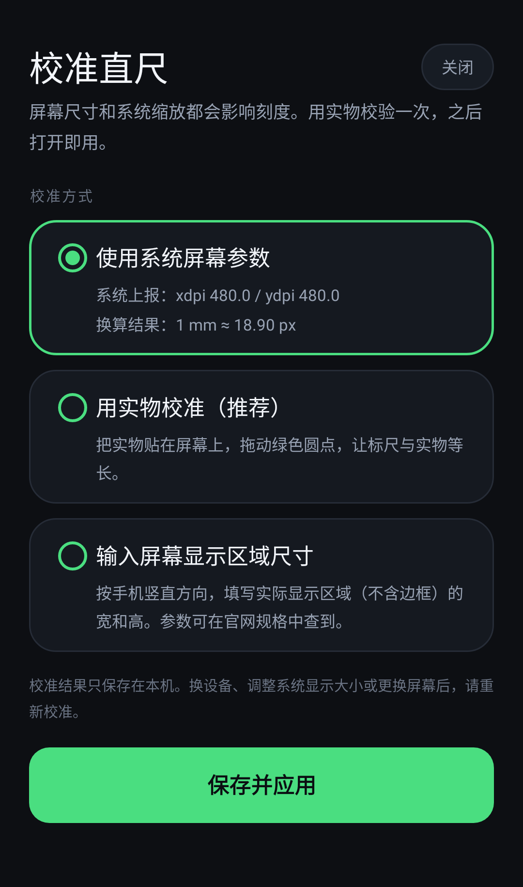

# 屏幕直尺 · Screen Ruler

中文 | [English](README_EN.md)

把 Android 手机屏幕变成一把随手可用的毫米直尺，适合临时测量小物件、纸片和配件。

<p align="center">
  
  
</p>

## 功能

- **打开即用**：默认读取系统上报的 `xdpi` / `ydpi` 换算刻度，不强制校准。
- **横向 / 纵向**：两种刻度方向，覆盖屏幕短边与长边。
- **两条测量线**：A、B 可拖动，直接显示两点间距离（mm / in）。
- **0.1 mm 微调**：拖动之外，可用 `±0.1 mm`、`±1 mm` 按键精确移动选中的测量点。
- **三种校准方式**：
  1. 系统参数（默认，免操作）
  2. 实物校准（银行卡短边 53.98 mm / 1 元硬币 25.00 mm）
  3. 输入屏幕显示区域的实际宽高（mm）
- **本地保存**：校准结果存在 `SharedPreferences`，不联网、不上传。
- **零权限**：不申请任何运行时权限。
- **屏幕常亮**：测量过程中不会自动熄屏。

## 截图

| 实物校准 | 系统参数 |
| --- | --- |
|  |  |

> 截图由 Robolectric 直接渲染真实布局生成，不是手工绘制的设计稿。

## 精度说明

网页版直尺无法自动获知屏幕物理尺寸、系统缩放和浏览器缩放，所以显示的“1 厘米”往往不是真的 1 厘米；原生 App 能读取系统提供的物理像素密度，起点更好，但**不等于自动达到毫米级精度**。

实际使用建议：

1. 第一次使用时，用银行卡或硬币做一次实物校验，确认刻度。
2. 换手机、换屏、调整系统“显示大小 / 屏幕分辨率”后，重新校验。
3. 测量时让物体尽量贴近屏幕，从同一角度读数，减少视差。
4. 屏幕边缘有圆角或贴膜时，尽量避开最边缘的 1–2 mm。

## 安装

安装包：[`dist/ScreenRuler-1.0.1.apk`](dist/ScreenRuler-1.0.1.apk)（`minSdk 24`，`targetSdk 35`）

```powershell
adb install -r dist\ScreenRuler-1.0.1.apk
```

也可以把 APK 传到手机上直接点击安装。为方便侧载，release 包使用本机 debug 签名；正式分发前请替换为自己的 keystore。

## 使用

1. 打开应用，默认按系统参数显示刻度，顶部会标注“系统参数 · 建议校验”。
2. 拖动 A、B 两条线到物体两端，顶部实时显示距离。
3. 需要更精确时，先点选 A 或 B，再用底部按键以 0.1 mm 步进微调。
4. 点右上角状态胶囊进入校准页，选择一种方式后点“保存并应用”。

## 构建

项目使用 Java + 原生 View，无第三方运行时依赖。

本机已验证的构建环境：

- JDK 17
- Android SDK Platform 35 / Build-Tools 35.0.0
- Gradle 8.13（项目自带 wrapper）

```powershell
$env:JAVA_HOME = "D:\Android\jdk17\jdk-17.0.21+9"
$env:ANDROID_HOME = "D:\Android\SDK"
cd D:\github\screen-ruler
.\gradlew.bat assembleRelease
```

生成的 APK：

```text
app\build\outputs\apk\release\app-release.apk
dist\ScreenRuler-1.0.1.apk
```

## 测试

启动流程和界面截图都通过 Robolectric 在 JVM 上验证，不需要真机：

```powershell
.\gradlew.bat testDebugUnitTest
```

- `MainActivityLaunchTest`：启动主界面与校准页的完整生命周期，防止“点击即闪退”回归。
- `DocsScreenshotTest`：用原生图形模式渲染真实布局，输出到 `docs/screenshots/`。

## 代码结构

```text
app/src/main/java/com/toolbox/screenruler/
  MainActivity.java        主界面、测量读数、横纵切换
  RulerView.java           刻度与测量线的自绘 View
  CalibrationActivity.java 三种校准方式
  ReferenceBarView.java    实物校准用的可拖动标尺
  CalibrationPrefs.java    校准参数与持久化
  EdgeToEdge.java          刘海屏 / 系统栏适配
```

## 已知限制

- 系统上报的 `xdpi` / `ydpi` 在部分机型上不准，尤其换过屏或开启过显示缩放时，所以保留了实物校准。
- 折叠屏、平板、外接显示器可能有不同的像素密度，切换屏幕后建议重新校准。
- 没有做相机辅助测量；测量对象需要直接贴在屏幕上。
- 测量的是两点在屏幕平面上的直线距离，不适用于曲面或悬空物体。

## 变更记录

- **1.0.1**
  - 修复点击图标立即闪退：`EdgeToEdge` 在 `setContentView` 前访问 `window.getInsetsController()`，此时 `DecorView` 尚未创建，Android 11+ 会抛 `NullPointerException`。
  - 修复纵向模式 `cm` 单位与末尾刻度重叠。
  - 修复校准页“实物校准”面板使用负外边距导致内容超出屏幕左侧。
  - 增加主界面与校准页的启动测试、真实布局截图测试。
- **1.0**：首个版本。
