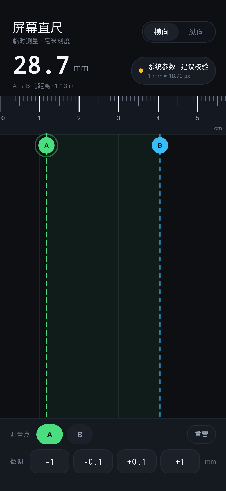
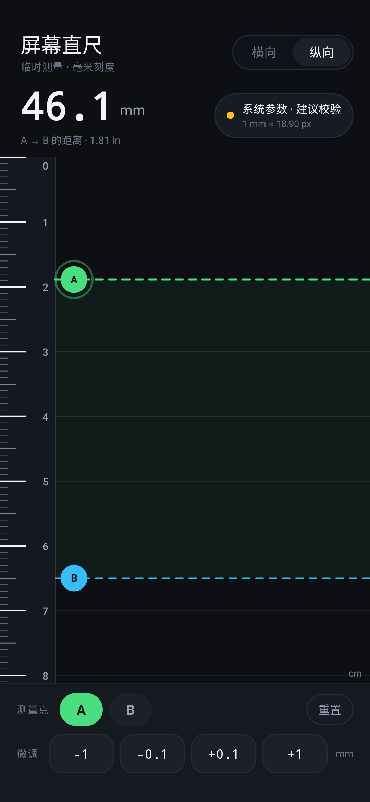
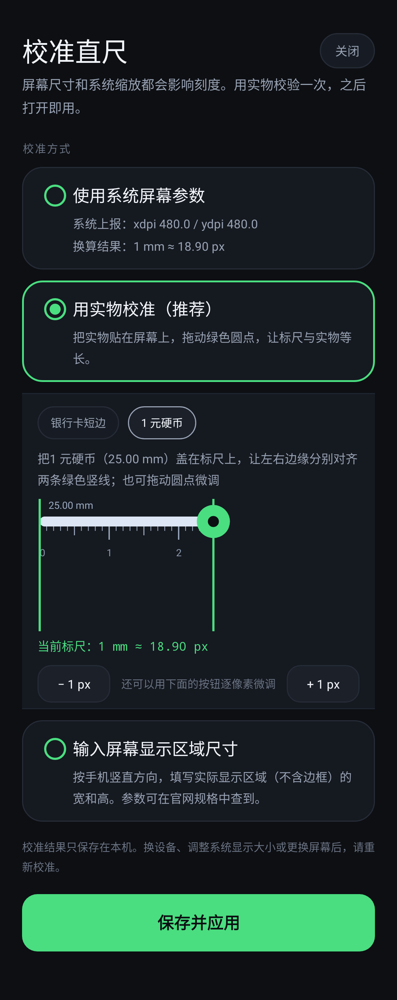
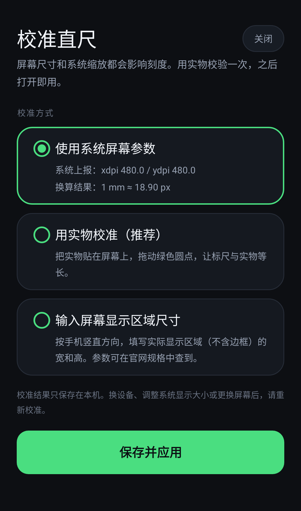

# Screen Ruler

English | [中文](README.md)

Turn an Android phone screen into a pocket millimeter ruler — handy for measuring small parts, paper, and hardware on the spot.

<p align="center">
  
  
</p>

## Features

- **Works out of the box** — converts the system-reported `xdpi` / `ydpi` into ticks, with no mandatory calibration.
- **Horizontal / vertical** — covers both the short and the long edge of the screen.
- **Two markers** — draggable A and B lines, with the distance shown in mm and inches.
- **0.1 mm nudging** — besides dragging, move the selected marker by `±0.1 mm` or `±1 mm`.
- **Three calibration methods**:
  1. System parameters (default, no interaction)
  2. Physical reference (bank card short edge, 53.98 mm / 1 CNY coin, 25.00 mm)
  3. Enter the real display area size in millimeters
- **Stored locally** — calibration lives in `SharedPreferences`; no network, no upload.
- **Zero permissions** — no runtime permissions requested.
- **Keep screen on** — the display stays awake while measuring.

## Screenshots

| Physical reference | System parameters |
| --- | --- |
|  |  |

> Screenshots are rendered from the real layouts by Robolectric, not hand-drawn mockups.

## Accuracy

A browser-based ruler cannot reliably know the physical screen size, the OS display scaling, or the browser zoom, so the "1 cm" it draws is often not a real centimeter. A native app starts from better data because it can read the physical pixel density reported by the system — but that still **does not guarantee millimeter accuracy**.

Practical advice:

1. Calibrate once with a bank card or a coin and check the ticks before trusting them.
2. Re-check after switching phones, replacing the screen, or changing the system display size / resolution.
3. Keep the object close to the screen and read from the same angle to reduce parallax.
4. Avoid the outermost 1–2 mm near rounded corners or screen protectors.

## Install

Package: [`dist/ScreenRuler-1.0.1.apk`](dist/ScreenRuler-1.0.1.apk) (`minSdk 24`, `targetSdk 35`)

```powershell
adb install -r dist\ScreenRuler-1.0.1.apk
```

You can also copy the APK to the phone and tap it to install. The release build is signed with the local debug keystore for easy sideloading — replace it with your own keystore before distributing.

## Usage

1. Open the app. Ticks are drawn from system parameters and the header shows "系统参数 · 建议校验" (system parameters, verification recommended).
2. Drag markers A and B to the two ends of the object; the distance updates live at the top.
3. For finer control, select A or B and use the bottom buttons to step by 0.1 mm.
4. Tap the status chip to open calibration, pick a method, then tap "保存并应用" (save and apply).

## Build

Java and native views only — no third-party runtime dependencies.

Verified build environment:

- JDK 17
- Android SDK Platform 35 / Build-Tools 35.0.0
- Gradle 8.13 (wrapper included)

```powershell
$env:JAVA_HOME = "D:\Android\jdk17\jdk-17.0.21+9"
$env:ANDROID_HOME = "D:\Android\SDK"
cd D:\github\screen-ruler
.\gradlew.bat assembleRelease
```

Outputs:

```text
app\build\outputs\apk\release\app-release.apk
dist\ScreenRuler-1.0.1.apk
```

## Tests

Startup and documentation screenshots are verified on the JVM with Robolectric — no device required:

```powershell
.\gradlew.bat testDebugUnitTest
```

- `MainActivityLaunchTest` — runs the full lifecycle of the main screen and calibration screen, guarding against the "crash on launch" regression.
- `DocsScreenshotTest` — renders the real layouts with native graphics into `docs/screenshots/`.

## Project layout

```text
app/src/main/java/com/toolbox/screenruler/
  MainActivity.java        Main screen, readout, orientation switch
  RulerView.java           Custom view that draws ticks and marker lines
  CalibrationActivity.java Three calibration methods
  ReferenceBarView.java    Draggable bar used for physical calibration
  CalibrationPrefs.java    Calibration values and persistence
  EdgeToEdge.java          Notch / system bar insets handling
```

## Known limitations

- Reported `xdpi` / `ydpi` is inaccurate on some devices, especially after a screen replacement or with display scaling enabled — that is why physical calibration exists.
- Foldables, tablets, and external displays may have different pixel densities; re-calibrate after switching screens.
- No camera-assisted measuring: the object must touch the screen.
- Measures straight-line distance in the screen plane, not curved or floating objects.

## Changelog

- **1.0.1**
  - Fixed the crash on launch: `EdgeToEdge` called `window.getInsetsController()` before `setContentView`, when the `DecorView` did not exist yet, causing a `NullPointerException` on Android 11+.
  - Fixed the `cm` unit label overlapping the last tick in vertical mode.
  - Fixed the physical-calibration panel overflowing the left edge because of negative margins.
  - Added launch tests for both screens and a real-layout screenshot test.
- **1.0**: Initial release.
